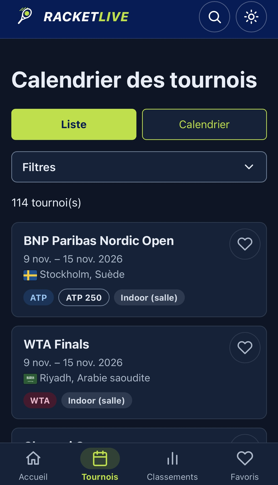
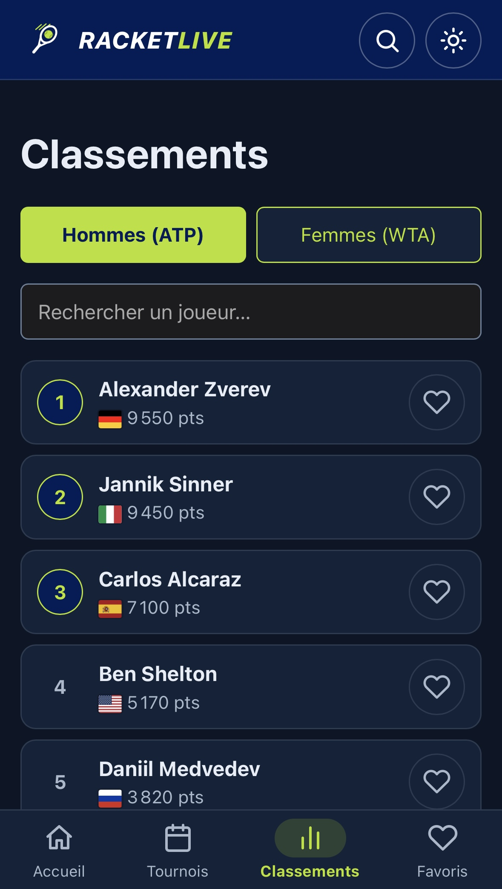
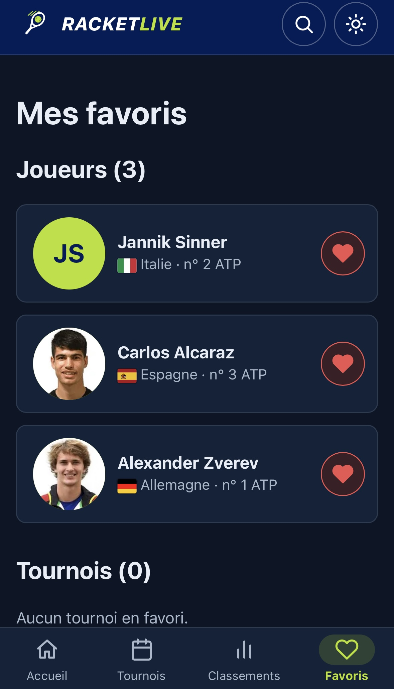

# RacketLive 🎾

Site de tennis, pensé d'abord pour le mobile : calendrier des tournois, classements ATP et WTA, fiches joueurs et favoris.

**Site en ligne : [racketlive.vercel.app](https://racketlive.vercel.app)**


## Fonctionnalités

- **Accueil** : tournois en cours, top 5 ATP et WTA, prochains tournois, favoris
- **Calendrier** en liste ou en vue mensuelle, avec filtres (circuit, catégorie, pays, mois)
- **Détail d'un tournoi** avec ses résultats, chargés à la demande
- **Classements** ATP et WTA avec recherche et pagination
- **Fiches joueurs**
- **Favoris** (joueurs et tournois) conservés dans le navigateur
- **Thème** clair et sombre
- **PWA** : installable sur l'écran d'accueil du téléphone, pages déjà vues disponibles hors connexion
- **Accessibilité** : lien d'évitement, navigation au clavier, contrastes, réduction des animations, messages d'erreur annoncés aux lecteurs d'écran

| Calendrier | Classements | Favoris |
| --- | --- | --- |
|  |  |  |

## Qualité

- Lighthouse en mobile : **100 / 100** en performances, accessibilité, bonnes pratiques et SEO
- Tests automatiques (Vitest) sur les dates, les favoris et la conversion des données
- Vérifications à chaque envoi sur GitHub : lint, tests et build (GitHub Actions)
- Chargement progressif : une page n'est téléchargée que lorsqu'on la visite
- Squelettes de chargement, message d'erreur avec bouton « Réessayer » et filet de sécurité contre l'écran blanc

## Technologies

React 19, Vite, React Router, CSS moderne (variables, mobile-first), Vitest, ESLint, GitHub Actions, Vercel.

## Lancer le projet

```bash
npm install      # installer les dépendances (une seule fois)
npm run dev      # lancer le site en développement
npm run build    # construire la version de production
npm run preview  # tester la version de production (la PWA n'y est active qu'ici)
npm run lint     # vérifier la qualité du code
npm test         # lancer les tests automatiques
```

## Organisation du code

```
src/
  components/   composants réutilisables (tournois, joueurs, interface…)
  pages/        une page par adresse du site
  services/api/ accès aux données (les pages passent toujours par ici)
  hooks/        logique réutilisable (thème, favoris, chargement, titre de page)
  utils/        petites fonctions (dates, libellés)
  data/         données lues par le site
scripts/        récupération et conversion des données de l'API
```

Les pages n'accèdent jamais directement aux fichiers de données : elles appellent les fonctions de `src/services/api`. Changer de source de données ne demande donc de modifier que ces services.

## Données

Les classements, tournois et résultats viennent de l'API « Tennis API – ATP WTA ITF » (Matchstat, via RapidAPI). Un script les télécharge, puis un convertisseur les met au format du site. La source et la date de dernière mise à jour sont affichées en bas de chaque page.

```bash
npm run donnees -- --liste   # voir les groupes de données disponibles
npm run donnees              # télécharger les données brutes (dans src/data/api, non versionné)
npm run convertir            # convertir les données brutes au format du site
```

Le script de téléchargement a besoin d'un fichier `.env` à la racine du projet (jamais envoyé sur GitHub) :

```
RAPIDAPI_KEY=ta_clé
RAPIDAPI_HOST=tennis-api-atp-wta-itf.p.rapidapi.com
```

Le forfait gratuit est limité à 50 requêtes par jour : le script compte les appels et s'arrête tout seul.

### Mise à jour automatique

Une action GitHub (`.github/workflows/mise-a-jour-donnees.yml`) télécharge chaque jour le calendrier, les classements et les résultats, les convertit et enregistre les changements. Vercel republie ensuite le site. Elle utilise deux secrets du dépôt, `RAPIDAPI_KEY` et `RAPIDAPI_HOST`, et consomme environ 31 requêtes par jour : évite les gros téléchargements manuels le même jour.

## À venir

- Matchs du jour sur l'accueil
- Fiches joueurs plus complètes et évolution des classements
